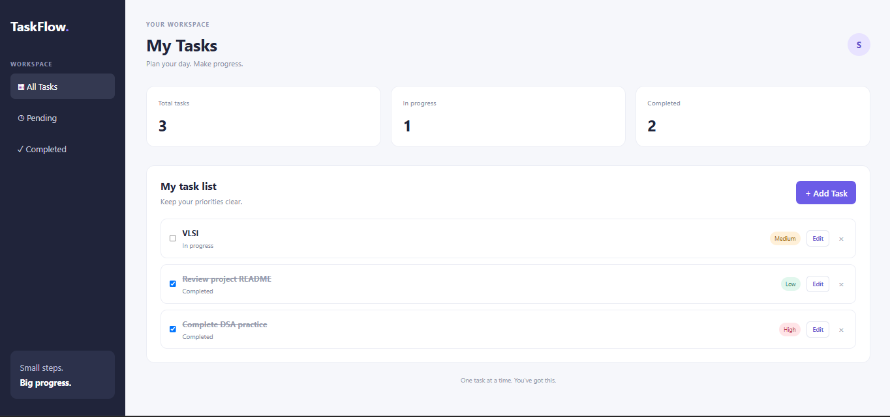

# TaskFlow – Full-Stack Task Management Application



**Live Demo:** [TaskFlow](https://thriving-nougat-abd826.netlify.app/)  
**Backend API:** [FastAPI Backend](https://taskflow-api-wbfe.onrender.com/)  
**API Documentation:** [Swagger UI](https://taskflow-api-wbfe.onrender.com/docs)  
**Source Code:** [GitHub Repository](https://github.com/im-SRASHTIAGARWAL/TaskFLow)

TaskFlow is a full-stack task management web application designed to help users organize daily activities, manage priorities, track deadlines, and monitor productivity through an interactive dashboard.

It combines a JavaScript frontend, Python FastAPI backend, JWT-based authentication, and PostgreSQL database to provide a complete task management experience.

---

## ✨ Features

### 1. User Authentication
- User registration and login.
- JWT-based authentication.
- Protected task management endpoints.
- User-specific task access.
- Password hashing.

### 2. Task Management
- Create, edit, and delete tasks.
- Mark tasks as completed or pending.
- Assign Low, Medium, and High priorities.
- Set task due dates.
- Persistent task storage.

### 3. Category-Based Organization

Organize tasks into four categories:
- Study
- Work
- Personal
- Projects

### 4. Dashboard Analytics

Monitor productivity through:
- Total tasks.
- Pending tasks.
- Completed tasks.
- Overdue tasks.

### 5. Search, Filtering & Sorting
- Search tasks by title.
- Filter tasks by status.
- Filter tasks by category and priority.
- Sort tasks by due date, priority, and creation date.

### 6. Calendar View
- Monthly calendar view.
- Weekly calendar view.
- Display tasks according to their due dates.
- Navigate between calendar periods.

### 7. Database Management
- PostgreSQL database hosted on Neon.
- SQLAlchemy ORM for database operations.
- Alembic for database schema migrations.
- SQLite fallback for local development.

### 8. Automated Testing
- Backend testing using Pytest.
- API testing using HTTPX.
- Tests for task management and authentication.

---

## 🛠️ Tech Stack

| Technology | Purpose |
|---|---|
| HTML5 | Frontend structure |
| CSS3 | Styling and responsive layout |
| JavaScript | Frontend interactivity and API integration |
| Python | Backend programming |
| FastAPI | REST API development |
| SQLAlchemy | ORM and database operations |
| PostgreSQL | Production database |
| Neon | Managed PostgreSQL hosting |
| SQLite | Local development database fallback |
| JWT | Authentication |
| Passlib / bcrypt | Password hashing |
| Alembic | Database migrations |
| Pytest | Automated testing |
| HTTPX | API testing |
| Git & GitHub | Version control |
| Netlify | Frontend deployment |
| Render | Backend deployment |

---

## 🏗️ System Architecture

```text
                  USER
                    |
                    v
            NETLIFY FRONTEND
             HTML / CSS / JS
                    |
               REST API
                    |
                    v
             FASTAPI BACKEND
                    |
           +--------+--------+
           |                 |
           v                 v
     JWT AUTHENTICATION   TASK APIs
           |                 |
           +--------+--------+
                    |
                    v
               SQLALCHEMY
                    |
                    v
            NEON POSTGRESQL
```

### Architecture Overview

- **Frontend:** HTML, CSS, and JavaScript deployed on Netlify.
- **Backend:** Python and FastAPI deployed on Render.
- **Authentication:** JWT-based authentication for protected endpoints.
- **Database:** Neon PostgreSQL for persistent production storage.
- **ORM:** SQLAlchemy for database operations.
- **Migrations:** Alembic for database schema management.
- **Testing:** Pytest and HTTPX for backend testing.

---

## 📁 Project Structure

```text
TaskFLow/
│
├── Backend/
│   ├── __init__.py
│   ├── main.py
│   ├── database.py
│   ├── database_old.py
│   ├── models.py
│   ├── schemas.py
│   ├── auth.py
│   └── user_schemas.py
│
├── migrations/
│   ├── env.py
│   └── versions/
│
├── frontend/
│   ├── index.html
│   ├── style.css
│   └── script.js
│
├── Screenshots/
│   └── Dashboard.png
│
├── .venv/
├── .gitignore
├── alembic.ini
├── requirements.txt
├── test_main.py
└── README.md
```

The virtual environment, environment variables, and local database files are excluded from version control where appropriate.

---

## ⚙️ Getting Started

### 1. Clone the Repository

```bash
git clone https://github.com/im-SRASHTIAGARWAL/TaskFLow.git

cd TaskFLow
```

### 2. Create and Activate a Virtual Environment

```bash
python -m venv .venv
```

On Windows PowerShell:

```powershell
.\.venv\Scripts\Activate.ps1
```

### 3. Install Dependencies

```bash
python -m pip install -r requirements.txt
```

### 4. Configure Environment Variables

Create a `.env` file in the project root:

```env
DATABASE_URL=your_postgresql_connection_string
SECRET_KEY=your_secure_secret_key
```

- `DATABASE_URL`: PostgreSQL connection string.
- `SECRET_KEY`: Secret key used for JWT authentication.

**Important:** Never upload your `.env` file, database credentials, or secret keys to GitHub.

### 5. Apply Database Migrations

Run from the project root:

```bash
alembic upgrade head
```

This applies pending database schema migrations.

### 6. Start the Backend

```bash
python -m uvicorn Backend.main:app --reload
```

The API will be available at:

- API Base URL: `http://127.0.0.1:8000`
- API Documentation: `http://127.0.0.1:8000/docs`
- Health Check: `http://127.0.0.1:8000/health`

When `DATABASE_URL` is not configured, the backend uses the local SQLite database fallback.

### 7. Launch the Frontend

Open `frontend/index.html` using the VS Code Live Server extension.

Ensure the frontend API configuration points to the correct backend URL.

---

## 🔌 API Endpoints

### Authentication APIs

| Method | Endpoint | Description |
|---|---|---|
| POST | `/auth/register` | Register a new user |
| POST | `/auth/login` | Authenticate an existing user |

### Task Management APIs

| Method | Endpoint | Description |
|---|---|---|
| GET | `/tasks` | Retrieve authenticated user's tasks |
| POST | `/tasks` | Create a new task |
| PUT | `/tasks/{task_id}` | Update an existing task |
| DELETE | `/tasks/{task_id}` | Delete a task |

### Utility APIs

| Method | Endpoint | Description |
|---|---|---|
| GET | `/` | Check API status |
| GET | `/health` | Check application and database health |

---

## 🧪 Running Tests

TaskFlow uses Pytest and HTTPX for backend testing.

Run the test suite from the project root:

```bash
python -m pytest test_main.py -v
```

The implemented test suite covers task CRUD operations, authentication, and access-control scenarios.

---

## ☁️ Deployment

| Component | Platform |
|---|---|
| Frontend | Netlify |
| Backend | Render |
| Production Database | Neon PostgreSQL |
| Source Code | GitHub |

### Production Links

- Frontend: https://thriving-nougat-abd826.netlify.app/
- Backend: https://taskflow-api-wbfe.onrender.com/
- API Documentation: https://taskflow-api-wbfe.onrender.com/docs

---

## 📚 Key Learnings

Developing TaskFlow provided practical experience in:

- Building RESTful APIs using FastAPI.
- Implementing JWT-based authentication.
- Connecting a JavaScript frontend with a Python backend.
- Performing CRUD operations using SQLAlchemy.
- Integrating PostgreSQL and SQLite.
- Managing database schema changes using Alembic.
- Writing and executing automated backend tests.
- Deploying frontend and backend applications independently.
- Debugging production API and database migration issues.

---

## 🔮 Future Improvements

- Forgot-password and password-reset functionality.
- Task reminders and notifications.
- Drag-and-drop task organization.
- Advanced productivity reports.
- Team collaboration and shared task management.

---

## 👩‍💻 Author

**Srashti Agarwal**  
Electronics & Communication Engineering Student | Aspiring Software Developer

- GitHub: [im-SRASHTIAGARWAL](https://github.com/im-SRASHTIAGARWAL)
- LeetCode: [Srashti_agarwal01](https://leetcode.com/u/Srashti_agarwal01/)
- HackerRank: [srashtiagarwal01](https://www.hackerrank.com/profile/srashtiagarwal01/)

---

⭐ If you find this project interesting, feel free to explore the repository!

*TaskFlow is a learning project built to gain hands-on experience in full-stack development, API design, authentication, database management, testing, and deployment.*
