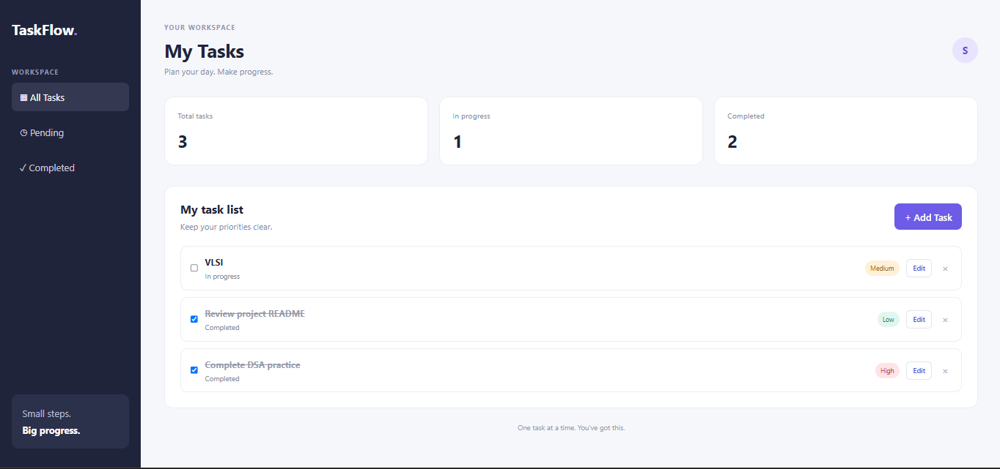

# TaskFlow — Full-Stack Task Management Application

**Live Demo:** [TaskFlow](https://thriving-nougat-abd826.netlify.app)  
**Source Code:** [GitHub Repository](https://github.com/im-SRASHTIAGARWAL/TaskFLow)

TaskFlow is a full-stack task management web application that helps users organize daily tasks, manage priorities, and track progress through a clean, interactive dashboard. It uses a JavaScript frontend, a Python FastAPI backend, and a PostgreSQL database.

## Application Preview



## Features

- **Create Tasks:** Add tasks with a title and priority.
- **View Tasks:** Display tasks in an organized dashboard.
- **Update Tasks:** Edit task details and mark tasks as completed.
- **Delete Tasks:** Remove tasks when no longer needed.
- **Filter Tasks:** View all, pending, or completed tasks.
- **Priority Management:** Assign Low, Medium, or High priority.
- **Persistent Database:** Store tasks in PostgreSQL in the deployed application.
- **Input Validation:** Validate task details and handle invalid requests.
- **REST API:** Perform task operations through FastAPI endpoints.
- **Automated Testing:** Test backend functionality using pytest.

## Tech Stack

| Technology | Purpose |
|---|---|
| HTML | Application structure |
| CSS | Styling and layout |
| JavaScript | Frontend interactivity and API integration |
| Python | Backend development |
| FastAPI | REST API development |
| PostgreSQL | Deployed application database |
| SQLite | Local development database fallback |
| psycopg | PostgreSQL database connectivity |
| pytest | Automated backend testing |
| HTTPX | API testing |
| Git & GitHub | Version control and source code hosting |
| Netlify | Frontend deployment |
| Render | Backend and PostgreSQL hosting |

## Architecture

- **Frontend:** HTML, CSS, and JavaScript, deployed on Netlify.
- **Backend:** Python and FastAPI, deployed on Render.
- **Database:** PostgreSQL, connected through the `DATABASE_URL` environment variable.
- **Local Development:** SQLite fallback when `DATABASE_URL` is not configured.
- **Testing:** pytest-based backend tests.

## Project Structure

```text
TaskFLow/
├── Backend/
│   ├── __init__.py
│   ├── main.py
│   └── database.py
├── frontend/
│   ├── index.html
│   ├── style.css
│   └── script.js
├── Screenshots/
│   └── Dashboard.png
├── test_main.py
├── requirements.txt
├── .gitignore
└── README.md
```

The `.venv/` directory and database files are excluded from version control.

## Getting Started

### 1. Clone the Repository

```bash
git clone https://github.com/im-SRASHTIAGARWAL/TaskFLow.git
cd TaskFLow
```

### 2. Create and Activate a Virtual Environment

On Windows PowerShell:

```powershell
python -m venv .venv
.\.venv\Scripts\Activate.ps1
```

### 3. Install Dependencies

```bash
python -m pip install -r requirements.txt
```

### 4. Start the Backend

Run from the project root:

```bash
python -m uvicorn Backend.main:app --reload
```

The API will be available at:

- API base URL: `http://127.0.0.1:8000`
- Interactive API documentation: `http://127.0.0.1:8000/docs`
- Health check: `http://127.0.0.1:8000/health`

When `DATABASE_URL` is not configured, the backend uses the local SQLite database. For PostgreSQL, configure `DATABASE_URL` with a valid PostgreSQL connection string.

### 5. Launch the Frontend

Open `frontend/index.html` using the VS Code Live Server extension.

The frontend communicates with the FastAPI backend to perform task operations. Ensure the backend is running and the frontend's API URL matches your local backend.

## API Endpoints

| Method | Endpoint | Description |
|---|---|---|
| GET | `/` | Check API status |
| GET | `/health` | Check application and database mode |
| GET | `/tasks` | Retrieve all tasks |
| POST | `/tasks` | Create a task |
| PUT | `/tasks/{task_id}` | Update a task |
| DELETE | `/tasks/{task_id}` | Delete a task |

## Running Tests

Run the test suite from the project root:

```bash
python -m pytest test_main.py -v
```

The automated tests cover task creation, retrieval, updates, deletion, missing tasks, and input validation.

## Key Learnings

- Designing RESTful APIs with FastAPI.
- Connecting a JavaScript frontend to a Python backend.
- Implementing CRUD operations.
- Integrating PostgreSQL and SQLite using a shared database interface.
- Validating user input and handling API errors.
- Writing automated tests with pytest and HTTPX.
- Configuring environment variables and deploying a full-stack application.
- Debugging production configuration and database connectivity.

## Future Improvements

- User authentication and individual task lists.
- Due dates, reminders, and task search.
- Improved accessibility and mobile responsiveness.
- More extensive integration tests for PostgreSQL.
- Long-term database hosting and backup configuration.

## Author

**Srashti Agarwal**  
Electronics and Communication Engineering Student

- GitHub: [im-SRASHTIAGARWAL](https://github.com/im-SRASHTIAGARWAL)

---

*TaskFlow is a learning project built to practice full-stack development, REST API design, database integration, deployment, and software testing.*
